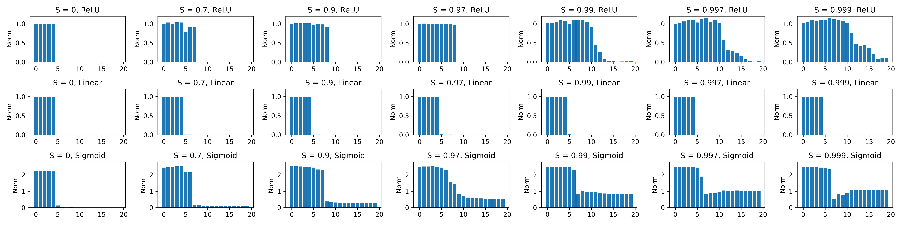
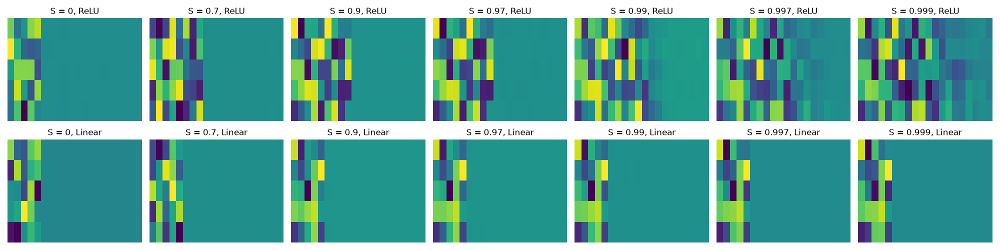
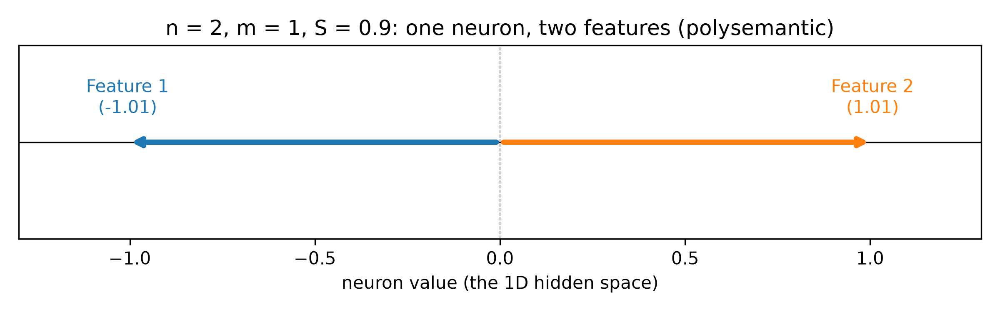

# Toy Models of Superposition: replication + a sigmoid extension

This repository is a replication of a result from Anthropic's 2022 paper "Toy Models of Superposition" (https://arxiv.org/abs/2209.10652).

The claim I tested: the higher the sparsity of the data, the more features a ReLU model packs into its hidden dimensions (20 features, 5 hidden dimensions).

## TL;DR

- **Linear vs ReLU:** My replication found that linear models did not show superposition, as the model kept only 5 features regardless of sparsity. ReLU on the other hand shows an increase in the number of features packed into only 5 hidden dimensions as sparsity increases: 5 at S = 0, 8 at S = 0.7, 9 at S = 0.9 to 0.97, and 11 or more at S ≥ 0.99.
- **Sigmoid extension:** I also tested sigmoid. At medium sparsity it shows superposition like ReLU, using antipodal pairs (up to 8 features at S = 0.9). At high sparsity, instead of packing in more features, it lumps the remaining features into one shared direction.
- **Bug fix:** I found and fixed a bug where the same model was reused across seeds and sparsity runs. All figures in this README are from after the fix.

## Setup

I followed the first experiment in the paper ("Demonstrating Superposition").

| | |
|---|---|
| Features (n) | 20 |
| Hidden dimensions (m) | 5 |
| Model | x' = act(WᵀWx + b), W is 5 × 20, tied weights, no hidden bias |
| Activations tested | Linear (none), ReLU, Sigmoid |
| Data | each feature is 0 with probability S, otherwise uniform in [0, 1] |
| Sparsity values (S) | 0, 0.7, 0.9, 0.97, 0.99, 0.997, 0.999 |
| Feature importance | 0.7^i for feature i |
| Loss | importance-weighted MSE (sum over features, mean over batch) |
| Init | Xavier |
| Optimizer | AdamW, lr 1e-3 |
| Training | 7000 steps, 1000 batch size , [0, 1, 2] seeds |

A fresh model is trained for every (activation, sparsity, seed) combination.

## Results

Feature numbers below are 0-indexed. Feature 0 is the most important.

### 1. Linear vs ReLU: how many features are kept

 


Each bar is the norm of one feature's weight column. A norm close to 1 means the model represents that feature, and a norm close to 0 means it dropped it.

- **Linear** keeps exactly 5 features (the 5 most important) at every sparsity. It has 5 dimensions, so it gives each of the top 5 features one dimension and ignores the rest.
- **ReLU** keeps 5 when the data is dense, but as sparsity increases it packs more in: 8 at S = 0.7, 9 at S = 0.9 to 0.97, and 11 or more at S ≥ 0.99. This matches the paper.

### 2. How ReLU fits more than 5 features: antipodal pairs

.png)

These are the Gram matrices (WᵀW). Square (i, j) shows how much feature i and feature j point in the same direction: red means same direction, blue means opposite, white means unrelated. Each row of plots shares one colour scale.

At medium sparsity ReLU forms **antipodal pairs**: two features that point in exactly opposite directions and share one dimension. This works because when one feature in the pair is active, the other one gets a negative value, and ReLU sets it to 0. Since the data is sparse, both features in a pair are rarely active at the same time.

Counting solo features and pairs, every case adds up to exactly 5 dimensions:

| Model | S | Features kept | Solo | Antipodal pairs | Solo + pairs |
|---|---|---|---|---|---|
| Linear | all | 5 | 0–4 | none | 5 |
| ReLU | 0 | 5 | 0–4 | none | 5 |
| ReLU | 0.7 | 8 | 0, 2 | (1,5) (3,6) (4,7) | 5 |
| ReLU | 0.9 | 9 | 0 | (1,5) (2,8) (3,7) (4,6) | 5 |
| ReLU | 0.97 | 9 | 0 | (1,5) (2,8) (3,7) (4,6) | 5 |
| Sigmoid | 0 | 5 | 0–4 | none | 5 |
| Sigmoid | 0.7 | 7 | 0, 1, 2 | (3,5) (4,6) | 5 |
| Sigmoid | 0.9 | 8 | 0, 1 | (2,6) (3,7) (4,5) | 5 |
| Sigmoid | 0.97 to 0.999 | 7 | 1, 2, 3 | (0,6) (4,5) | 5 |

At S ≥ 0.99, ReLU stops using clean pairs and packs features into more complex shapes, which the paper covers in its geometry section. I didn't count those.

### 3. The smallest case: 2 features, 1 dimension



To check the idea at its simplest, I trained a ReLU model with 2 features and 1 hidden dimension. The learned weights converge to the form [a, −a], the two features point in opposite directions along the single dimension, which is one antipodal pair.

### 4. Extension: sigmoid

The paper only uses ReLU, so I wanted to see if superposition also happens with sigmoid. Before running it, I predicted superposition would increase as sparsity increases.

What happened:

- **Dense data (S = 0):** sigmoid keeps 5 features, the same as linear and ReLU.
- **Medium sparsity (S = 0.7 to 0.9):** sigmoid shows superposition with antipodal pairs, just like ReLU, up to 8 features at S = 0.9.
- **High sparsity (S ≥ 0.97):** this is where it differs from ReLU. ReLU keeps fitting in more distinct features, but sigmoid stays at 7 and the rest of the features end up in **one shared direction**. In the Gram matrix this shows up as a flat block in the bottom right with no stronger diagonal, so those features overlap with each other as much as with themselves and can't be told apart. That shared direction also points against the solo features (1, 2, 3).

Sigmoid's head features also have norms around 2.5 instead of 1. That is expected: sigmoid's slope is at most 0.25, so it needs bigger weights to cover the same output range.

## Bug fix

In my first version, the same model object was reused across seeds and sparsity values, so every run after the first started from weights that were already trained. The loss started very low almost the same as the last epoch. After I fixed it so every run trains a fresh model, RELU model in superposition_weights_bar and superposition_weights_map figures showed more features as sparsity increases. All figures in this README are from after the fix.

## Limitations

- I only tested one model size (20 features, 5 dimensions) and the 7 sparsity values above.
- 0, 1, 2 seeds per setting.
- The solo/pair counts were read from the Gram matrices by eye, not with a fixed numeric threshold.
- I did not reproduce the paper's phase diagrams or its geometry section.
- For sigmoid, I didn't check per-feature loss, so I can't yet say how well the shared-direction features are actually reconstructed. I also used the same hyperparameters as ReLU, which may not suit sigmoid (its gradients get very small in the flat regions).

## How to run

```bash
python -m venv .venv
source .venv/bin/activate
pip install -r requirements.txt
```

Then open `superposition.ipynb` and run all cells. The figures are saved as PNGs in the repo folder. Runtime: ~10 mins (give or take). My Specs: Intel Core 7 150U: 10 cores / 12 threads, boosts up to 5.4 GHz, 16GB RAM,  Intel integrated graphics (Raptor Lake-U).

## Why I did this

Superposition is one of the main reasons neural networks are hard to interpret: if features don't line up with dimensions, you can't just read a network one neuron at a time. I wanted to see that happen with my own code instead of only reading about it. It's also part of why I'm interested in models whose outputs are interpretable by construction, rather than relying only on reverse-engineering them afterwards.

## References

- Elhage et al. (2022), "Toy Models of Superposition", https://arxiv.org/abs/2209.10652
- Interactive version: https://transformer-circuits.pub/2022/toy_model/index.html